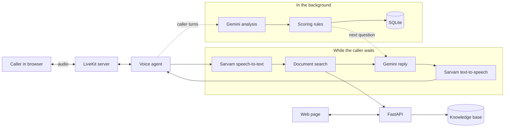

# Autonomous AI Sales Voice Agent

A voice agent that talks to a sales prospect in **English, Hindi or Hinglish**, answers
product questions from company documents, and qualifies the lead while the call is
still running.

It is a working prototype (MVP) that runs in the browser on one machine.

## Contents

- [Business problem](#business-problem)
- [Features and status](#features-and-status)
- [How it works](#how-it-works)
- [Technology stack](#technology-stack)
- [Quick start](#quick-start)
- [Using the app](#using-the-app)
- [Configuration](#configuration)
- [API](#api)
- [Testing and evaluation](#testing-and-evaluation)
- [Security and privacy](#security-and-privacy)
- [Scaling and cost](#scaling-and-cost)
- [Known limitations](#known-limitations)
- [Troubleshooting](#troubleshooting)
- [Project structure](#project-structure)

## Business problem

Sales teams lose leads because enquiries wait for a person, first calls repeat the same
qualification questions, many buyers prefer Hindi or Hinglish, and call notes are
incomplete. This agent responds without waiting for a salesperson, asks consistently, and
records what the prospect needs, can spend, decides and expects.

## Features and status

| Feature | Status | What it does |
|---|---|---|
| Real-time voice | Built | Streaming speech-to-text and text-to-speech; the caller can interrupt |
| Multilingual conversation | Built | Detects English, Hindi and Hinglish and switches the reply and voice |
| Contextual memory | Built | Remembers lead facts, summarises long calls, recognises a returning browser |
| Knowledge retrieval (RAG) | Built | Answers from uploaded documents and logs unanswered questions |
| Lead qualification | Built | Rule-based score out of 100 with Hot, Warm or Cold grade |
| Sentiment analysis | Built | Per-turn sentiment from the words spoken, with a follow-up flag |
| Call summary and business insights | **Not built yet** | Planned next phase |
| Appointment booking, CRM, phone calls | Out of scope | Not part of this MVP |

## How it works

The system has two paths, so a reply never waits for lead analysis.



**One turn:** the speech service detects the end of speech → the agent searches the
documents → Gemini receives the instructions, known lead facts, matching passages and
reply language → the reply is converted to speech as it is generated.

### Knowledge retrieval (RAG)

1. A document is read and split into passages of up to 220 words, keeping headings.
2. Each passage is embedded with `multilingual-e5-large`, which runs locally.
3. A question is searched by meaning (vectors) and by keywords; the rankings are merged.
4. Up to 4 passages above a similarity of 0.78 are added to the caller's question.
5. If none match, the agent is told to defer to a specialist, and a question is logged as
   a knowledge gap.

### Lead qualification

Gemini extracts facts. **Fixed rules calculate the score**, so every score can be explained.

| Criterion | Points | Full points when |
|---|---|---|
| Need | 30 | A specific problem is described |
| Budget | 25 | The monthly amount covers the cheapest plan |
| Authority | 20 | The caller decides or influences the decision |
| Timeline | 25 | Purchase expected within 3 months |

**Hot** is 70 or more, **Warm** 40 to 69, **Cold** below 40. A qualification fact is
accepted only if its quoted words appear in what the caller said. Two negative turns in a
row flag the call for human follow-up. Sentiment does not change the score.

The full design, including the scale-up target, is in
[docs/SYSTEM_DESIGN.md](docs/SYSTEM_DESIGN.md).

## Technology stack

| Layer | Technology |
|---|---|
| Real-time media and agent | LiveKit server and LiveKit Agents 1.8 (Python) |
| Speech-to-text and text-to-speech | Sarvam (`saaras:v4`, `bulbul:v4-flash`) |
| Interruption detection | Silero voice activity detection |
| Language model | Google Gemini (`gemini-3.5-flash-lite`) |
| Embeddings | `intfloat/multilingual-e5-large` through FastEmbed, on CPU |
| Backend | FastAPI |
| Storage | SQLite (full-text index and vector comparison) |
| Frontend | Next.js, React, TypeScript, LiveKit client |

## Quick start

### 1. Requirements

- Linux with Bash 4.3 or newer for `scripts/start.sh` (developed on Linux only)
- Python 3.12 and Node.js 20.9 or newer
- About 5 GB of free disk space, including a 2.2 GB model download
- A microphone, preferably with headphones
- API keys for [Sarvam](https://dashboard.sarvam.ai) and
  [Google Gemini](https://aistudio.google.com/apikey)

### 2. Install

```bash
git clone https://github.com/Aditya51002/Autonomous-AI-Sales-Voice-Agent.git
cd Autonomous-AI-Sales-Voice-Agent

python3.12 -m venv .venv
.venv/bin/pip install -r requirements.txt
(cd apps/web && npm install)
cp .env.example .env
```

Install the LiveKit server from the
[official releases](https://github.com/livekit/livekit/releases) into a folder on your
`PATH` (such as `~/.local/bin`), or run `curl -sSL https://get.livekit.io | bash`.
A [LiveKit Cloud](https://cloud.livekit.io) project can be used instead.

### 3. Add your keys

Edit `.env`:

```dotenv
SARVAM_API_KEY=your_sarvam_key
GEMINI_API_KEY=your_gemini_key
```

The LiveKit values in the file already match a local `livekit-server --dev`. For LiveKit
Cloud, replace the three `LIVEKIT_` values. Never commit `.env`.

### 4. Run

```bash
bash scripts/start.sh
```

This starts the LiveKit server (when `.env` points to this machine), the API, the voice
agent and the web app. Logs are written to `logs/`. Press Ctrl+C to stop.

To run each service in its own terminal instead:

```bash
livekit-server --dev
.venv/bin/uvicorn apps.api.main:app --port 8000
.venv/bin/python -m apps.agent.main dev
cd apps/web && npm run dev
```

The first start downloads the embedding model to `~/.cache/fastembed`. Wait for
`knowledge search is ready` in the API log before calling.

## Using the app

Open http://localhost:3000.

1. Under **Product documents**, upload both files from `data/sample/`. These describe a
   fictional company, so set `COMPANY_NAME` and `PRODUCT_DESCRIPTION` in `.env` to match
   your documents.
2. Tick the consent box and choose **Start call**.
3. Talk to the agent. The page shows the transcript, lead panel, document sources and
   latency.
4. Choose **End call**. **Forget me** erases the stored lead and transcripts.

### Demonstration script

| Say or do | What should happen |
|---|---|
| "I am Priya from Sharma Traders. Invoices take us two days." | Name, company and need appear in the lead panel |
| "Growth plan की कीमत कितनी है?" | Hindi voice; price taken from the documents |
| Talk over the answer | The agent stops and listens |
| "Do you sell laptops?" | No matching passage; logged as a knowledge gap |
| "I am the owner, we start next month, budget ₹2,000 a month." | The score rises |
| Complain about the price twice | A follow-up warning appears |
| End the call and start another | The agent already knows your details |

Lead analysis runs in the background, so the panel can lag a turn or two.

## Configuration

All settings are read from `.env`. [.env.example](.env.example) lists them.

| Setting | Default | Purpose |
|---|---|---|
| `COMPANY_NAME`, `AGENT_NAME`, `PRODUCT_DESCRIPTION` | Demo values | Who the agent is and what it sells |
| `LLM_MODEL` | `gemini-3.5-flash-lite` | Model for live replies; must be a Gemini model |
| `ANALYSIS_MODEL` | `gemini-3.5-flash-lite` | Model for lead analysis and call memory |
| `TTS_SPEAKER` | `simran_enhi_customer` | Voice. The instructions assume a female agent |
| `RETRIEVAL_MIN_SCORE` | `0.78` | Minimum similarity for a passage to be used |
| `MIN_MONTHLY_BUDGET_INR` | `499` | Cheapest plan price, used for budget scoring |
| `MEMORY_WINDOW` | `12` | Recent messages kept word for word |
| `MAX_CALL_SECONDS` | `600` | Call time limit |

All vendor-specific code for speech and the language model is in
[apps/agent/providers.py](apps/agent/providers.py).

## API

The API runs on http://localhost:8000, with interactive documentation at `/docs`.

| Method and path | Purpose |
|---|---|
| `GET /health` | Health check |
| `POST /calls` | Create a call and return a room token; requires consent |
| `POST /documents` | Upload a PDF, DOCX, Markdown or text file (up to 5 MB) |
| `GET /documents` | List documents |
| `DELETE /documents/{id}` | Remove a document |
| `POST /search` | Search the knowledge base |
| `GET /knowledge-gaps` | Questions the documents could not answer |
| `DELETE /leads/{lead_id}` | Erase a lead, its calls and transcripts |

## Testing and evaluation

### Offline tests

```bash
.venv/bin/python -m pytest
```

The 67 tests cover language rules, model requests, document search, scoring, memory,
storage and the API. They need no keys and do not test live audio.

### Evaluation scripts

| Command | Measures | Uses paid APIs |
|---|---|---|
| `.venv/bin/python -m scripts.eval_retrieval` | Retrieval accuracy and search time | No |
| `.venv/bin/python -m scripts.eval_qualification` | Lead grades on scripted calls | Gemini |
| `.venv/bin/python -m scripts.benchmark --runs 5` | Reply and speech latency | Gemini and Sarvam |
| `.venv/bin/python -m scripts.simulate_call` | A full call with synthesized speech (services must be running) | Gemini and Sarvam |

### Results from development (November 2026)

| Measure | Result | Design target |
|---|---|---|
| Correct passage in the top 4 | 24 of 25 questions | 90% |
| Unrelated questions rejected | 7 of 8 | No target |
| Search time | about 43 ms | No target |
| Lead grade as expected | 5 of 5 scripted calls | 85% on 20 calls |
| Wait from end of caller audio to reply audio | 3.2 to 4.3 s | 1.5 s or less |

Read these with care:

- Retrieval was measured on 16 sample passages, and the threshold was tuned on the same
  questions.
- The analysis instructions were adjusted using the same 5 calls (the first run scored 4).
  One request in the second run also failed with a model "high demand" error.
- The latency figures come from one simulated call with synthesized speech.
- **Latency does not meet the target.** The web page's *Total* column shows lower values
  because it starts counting when the speech service reports the end of speech.

## Security and privacy

**In place**

- The caller must consent, and the agent states that it is an AI and the call is transcribed.
- Each room token lasts 10 minutes and joins one new room.
- Transcripts and lead facts are stored with email addresses, PAN numbers and long digit
  sequences (such as card or phone numbers) redacted. The app does not store audio.
- Returning callers are identified by a random browser id, not a name or phone number.
- **Forget me** erases the lead, its calls and transcripts.
- Caller speech and documents are treated as untrusted; extracted data is schema-checked.
- Secrets stay in `.env`, which Git ignores.

**Not yet in place: do not expose this prototype to the internet**

- No login, roles or rate limits on the API. The origin check only blocks other websites
  in a browser.
- No encryption of the local databases and no automatic retention period.
- Logged knowledge-gap questions are not redacted and are not removed by **Forget me**.
- Caller audio and text are processed by Sarvam, and text by Google. Review their data
  terms before using real customer data, especially on free API tiers.

## Scaling and cost

The design covers growth to 1,00,000 users with autoscaled agent workers, PostgreSQL with
pgvector, Redis for state and queues, and fallback providers. It estimates about
**₹3.6 variable cost per call minute**. These are planning estimates that have not been
load-tested. Assumptions are in [docs/SYSTEM_DESIGN.md](docs/SYSTEM_DESIGN.md).

## Known limitations

- Call summaries and the business insights dashboard are not built yet.
- Replies take several seconds, and model "high demand" errors can leave a call silent.
- Sentiment is based on words only, not tone of voice.
- Lead facts are what the caller claims; sales staff should confirm them.
- Scanned PDFs need OCR first.
- SQLite and in-process memory suit one machine, not production scale.

## Troubleshooting

| Problem | What to try |
|---|---|
| `Missing settings: ...` | Add the named values to `.env` and save the file |
| `Port ... is already in use` | The app is already running; stop it first |
| Page stays on "Waiting for the agent" | Check that the agent log shows `registered worker` |
| Agent keeps saying a specialist will confirm | Upload documents and wait for `knowledge search is ready` |
| `LLM_MODEL is ..., but this project uses Google Gemini` | Set a Gemini model in `.env` |
| Long pauses or no reply | Check `logs/agent.log` for rate-limit or "high demand" errors |
| No sound or no transcript | Allow microphone access and reload the page |

## Project structure

```text
apps/
  agent/          Voice worker: pipeline, prompts, language, memory, live analysis
  api/            Calls, documents, search and lead deletion
  web/            Next.js call page
packages/core/
  knowledge/      Parsing, chunking, embeddings, storage and search
  leads/          Facts, scoring, redaction and storage
data/sample/      Fictional demo documents (local databases are created in data/)
docs/             System design and diagrams
evals/            Retrieval questions and scripted sales calls
scripts/          Start script, benchmark, evaluations and call simulation
tests/            Offline tests
```
