# How the AI Sales Voice Agent Works

A detailed map of the system **as it is built today**: what is used, why, what it does and
how the parts connect. The scale-up design is in [SYSTEM_DESIGN.md](SYSTEM_DESIGN.md).

## Visual overview

Colours: blue is the browser, purple is LiveKit, green is the voice agent, orange is an
external AI service, yellow is the API and grey is storage.

### System overview

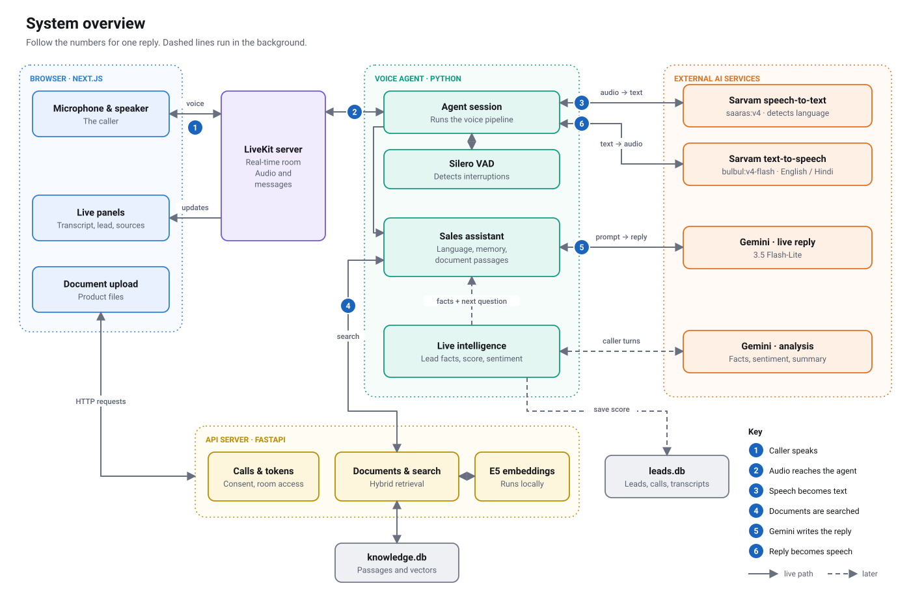

### One conversation turn

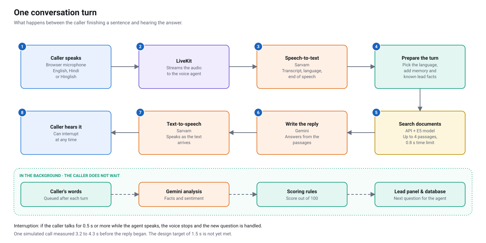

### Knowledge retrieval (RAG)

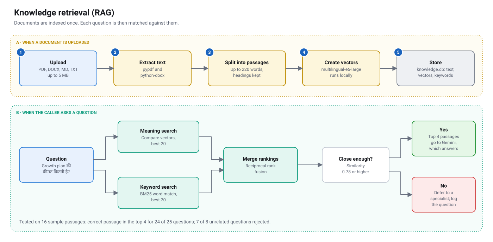

### Lead qualification and sentiment

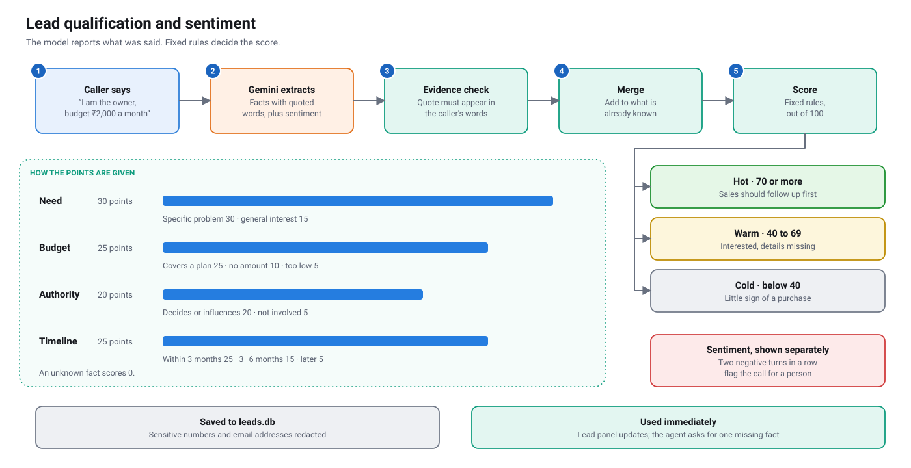

To change these images, edit [diagrams/build.py](diagrams/build.py) and run it again.
The sections below give the full detail.

## Contents

1. [The whole system](#1-the-whole-system)
2. [What we use and why](#2-what-we-use-and-why)
3. [Starting a call](#3-starting-a-call)
4. [One conversation turn](#4-one-conversation-turn)
5. [Interrupting the agent](#5-interrupting-the-agent)
6. [Choosing the language](#6-choosing-the-language)
7. [Knowledge retrieval (RAG)](#7-knowledge-retrieval-rag)
8. [Lead qualification and sentiment](#8-lead-qualification-and-sentiment)
9. [Memory](#9-memory)
10. [Ending a call](#10-ending-a-call)
11. [Stored data](#11-stored-data)
12. [Every connection](#12-every-connection)
13. [When something fails](#13-when-something-fails)
14. [Not built](#14-not-built)

## 1. The whole system

Solid arrows are used while the caller waits. Dotted arrows happen in the background.

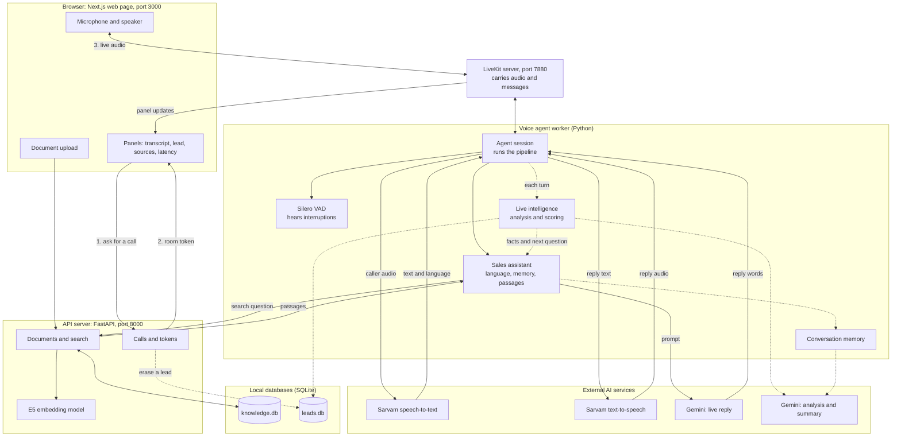

**In one sentence:** the browser sends the caller's voice through LiveKit to the agent,
which turns it into text, looks up the documents, asks Gemini for a reply and speaks it,
while a background task works out who the lead is and how interested they are.

## 2. What we use and why

### Services and libraries

| What we use | Purpose | What exactly it does here |
|---|---|---|
| **LiveKit server** | Real-time transport | Creates one room per call; carries audio both ways, transcripts and panel data |
| **LiveKit Agents** | Voice pipeline | Connects speech-to-text, model and speech; manages turns and interruptions |
| **Silero VAD** | Interruption detection | Runs locally and notices when the caller starts talking |
| **Sarvam `saaras:v4`** | Speech-to-text | Turns speech into text, detects the language and the end of speech |
| **Sarvam `bulbul:v4-flash`** | Text-to-speech | Speaks the reply with an English or Hindi voice setting |
| **Gemini 3.5 Flash-Lite** | Language model | Writes replies, extracts lead facts and sentiment, summarises long calls |
| **FastEmbed with `multilingual-e5-large`** | Embeddings | Turns text into vectors so a Hindi question can match English text |
| **FastAPI** | Backend API | Issues call tokens, manages documents, runs search, erases leads |
| **SQLite** | Storage | Holds documents, passages, vectors, leads, calls and transcripts |
| **Next.js and React** | Web page | Call controls, live panels and document upload |
| **Pydantic** | Validation | Checks settings, API input and the model's structured output |

### Our own code

| File | Role |
|---|---|
| [apps/agent/main.py](../apps/agent/main.py) | Builds the parts for each call and connects their events |
| [apps/agent/assistant.py](../apps/agent/assistant.py) | Greeting; prepares every turn with language, memory and passages |
| [apps/agent/providers.py](../apps/agent/providers.py) | The only place that chooses the speech and model vendors |
| [apps/agent/prompts.py](../apps/agent/prompts.py) | Instructions given to the model and fixed phrases |
| [apps/agent/language.py](../apps/agent/language.py) | Decides English, Hindi or Hinglish |
| [apps/agent/retrieval.py](../apps/agent/retrieval.py) | Asks the API for passages; skips small talk |
| [apps/agent/intelligence.py](../apps/agent/intelligence.py) | Background analysis queue, guidance and lead panel data |
| [apps/agent/memory.py](../apps/agent/memory.py) | Summarises older messages |
| [apps/agent/latency.py](../apps/agent/latency.py) | Converts timing measurements for the page |
| [apps/api/main.py](../apps/api/main.py) | Call tokens, health check, lead deletion |
| [apps/api/knowledge.py](../apps/api/knowledge.py) | Document and search endpoints |
| [packages/core/knowledge/](../packages/core/knowledge/) | Read, split, embed, store and search documents |
| [packages/core/leads/](../packages/core/leads/) | Fact schema, merge rules, scoring, redaction, storage |
| [packages/core/config.py](../packages/core/config.py) | All settings, read from `.env` |
| [apps/web/](../apps/web/) | The web page; `lib/useCall.ts` handles the live connection |

## 3. Starting a call

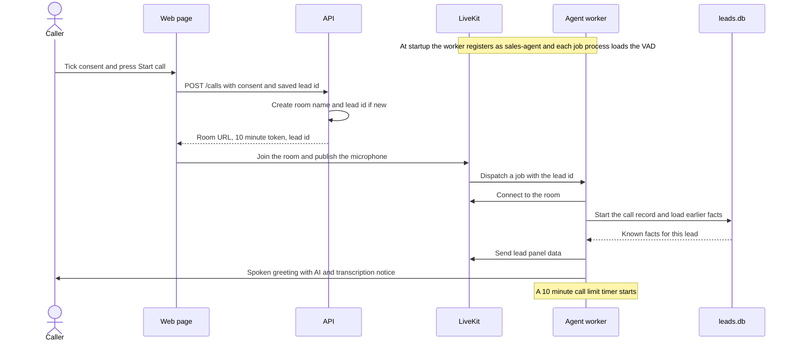

The lead id is a random value kept in the browser. It is not a name or phone number.

## 4. One conversation turn

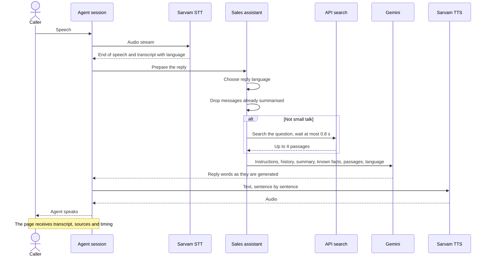

### What goes into the prompt

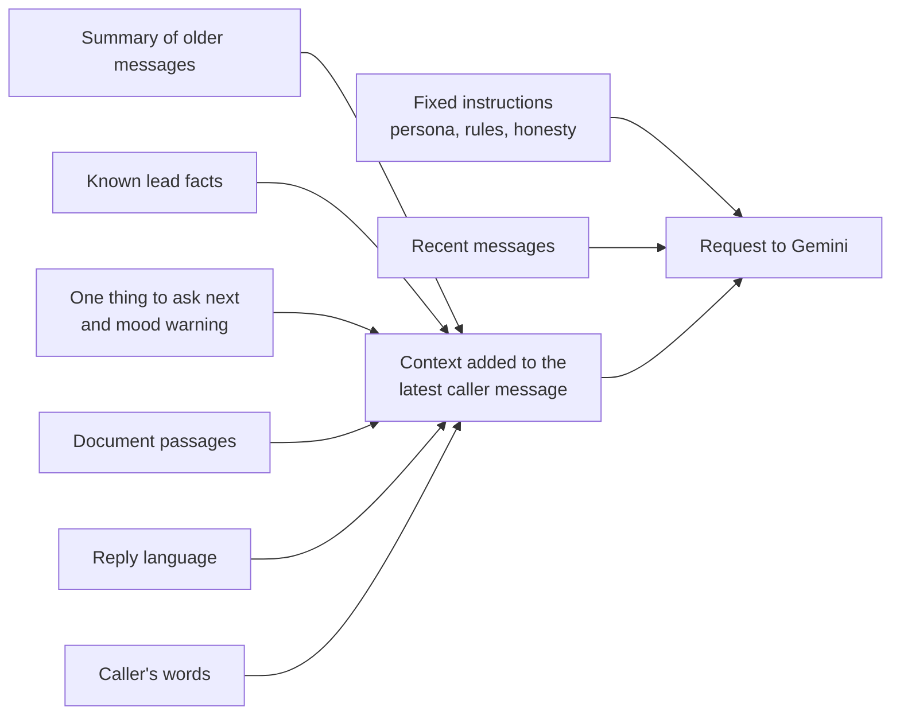

The added context is used for that request only and is not saved into the history.

## 5. Interrupting the agent

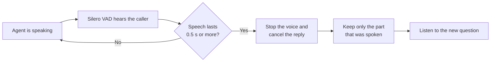

LiveKit Agents handles these steps; our settings choose the detector and the 0.5 s limit.

## 6. Choosing the language

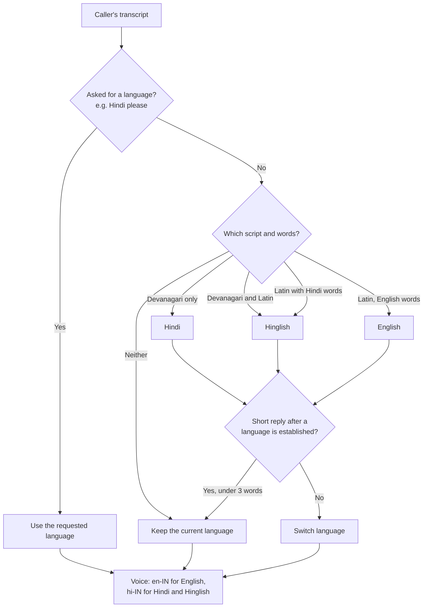

The same decision is written into the prompt, so the words and the voice agree.

## 7. Knowledge retrieval (RAG)

### Adding a document

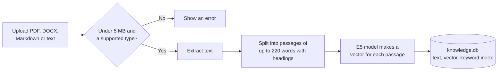

Uploading a file with the same name replaces the earlier version.

### Searching

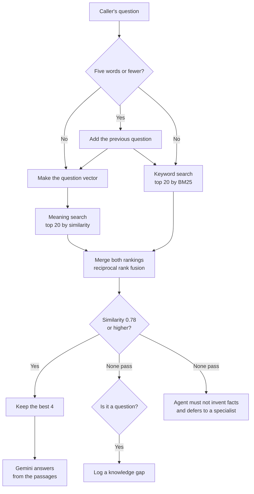

## 8. Lead qualification and sentiment

This runs in the background, so the caller never waits for it.

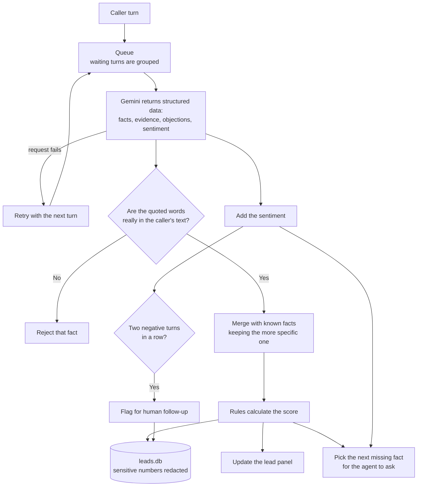

The evidence check applies to need, budget, authority, timeline, name and company.

### Score rules

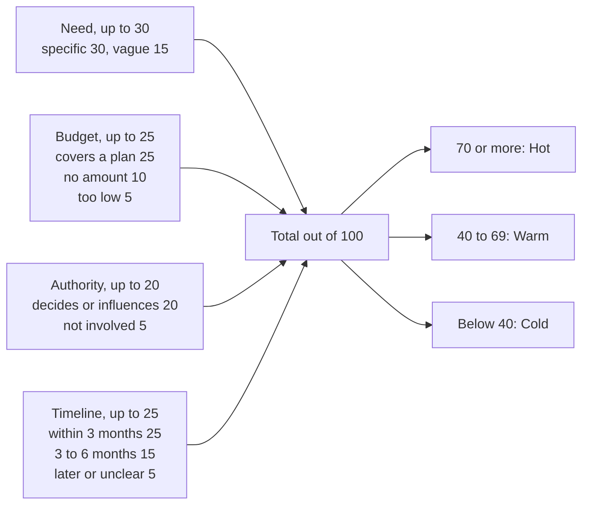

An unknown fact scores 0. Sentiment is shown beside the score and does not change it.

## 9. Memory

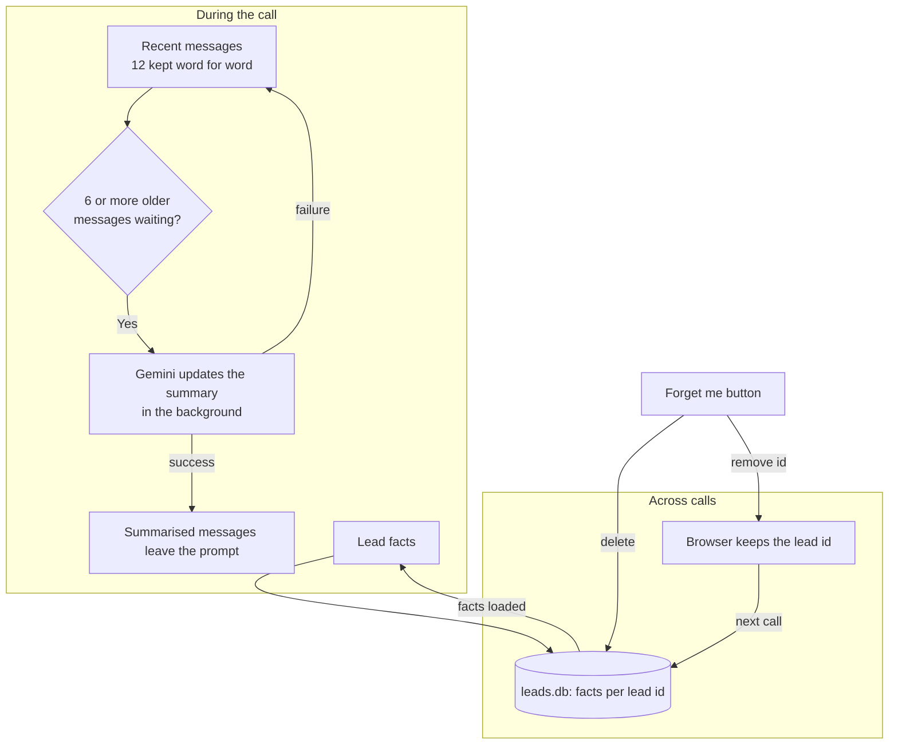

The summary lasts only for the current call. Lead facts carry over to the next one.

## 10. Ending a call

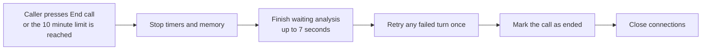

No end-of-call summary is produced yet.

## 11. Stored data

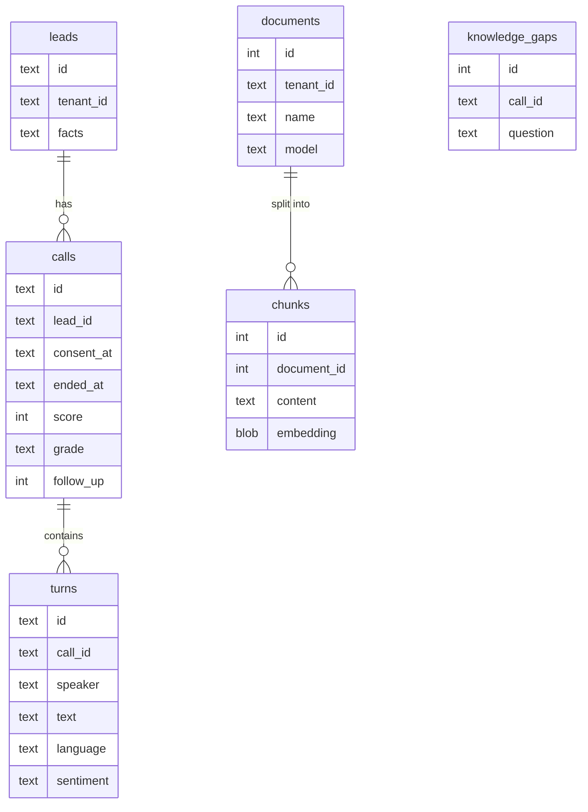

`leads`, `calls` and `turns` are in `data/leads.db`. The others are in
`data/knowledge.db`, which also has a keyword index of the passages. Audio is not stored
by the app.

## 12. Every connection

| From | To | How | What is sent |
|---|---|---|---|
| Web page | API | HTTP | Consent, lead id, documents, delete requests |
| Web page | LiveKit | WebRTC | Microphone audio; receives agent audio |
| Agent | LiveKit | WebRTC | Agent audio, state and transcript |
| Agent | Web page, through LiveKit | Data messages `lead`, `sources`, `latency` | Panel updates |
| Agent | Sarvam | WebSocket | Caller audio, reply text |
| Agent | Gemini | HTTPS | Prompts, caller turns, summaries |
| Agent | API | HTTP `POST /search` | Search question and call id |
| Agent | `leads.db` | Direct file access | Calls, turns, facts, scores |
| API | `knowledge.db` | Direct file access | Documents, vectors, gaps |
| API | `leads.db` | Direct file access | Lead deletion |

**Leaves your computer:** audio and reply text go to Sarvam; prompts, including caller
words and document passages, go to Gemini. Embeddings are computed locally.

## 13. When something fails

| Failure | What happens |
|---|---|
| Document search is slow or down | The reply continues without passages; the agent should not claim facts |
| Lead analysis fails | The conversation continues; those turns are retried with the next one |
| Summary fails | The older messages stay in the prompt |
| Live reply model is overloaded | The library retries; the call may pause or stay silent |
| Panel message cannot be sent | It is ignored, usually because the call ended |
| A required key is missing | The agent stops at startup and names it |

## 14. Not built

| Feature | Note |
|---|---|
| End-of-call summary and business insights dashboard | Next planned phase |
| Appointment booking | Out of the current scope |
| CRM integration | Out of the current scope |
| Phone calls | Browser calls only |
| Login, roles and rate limits | Needed before any internet deployment |
