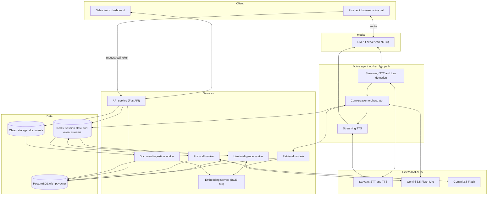
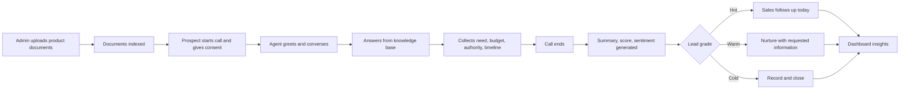
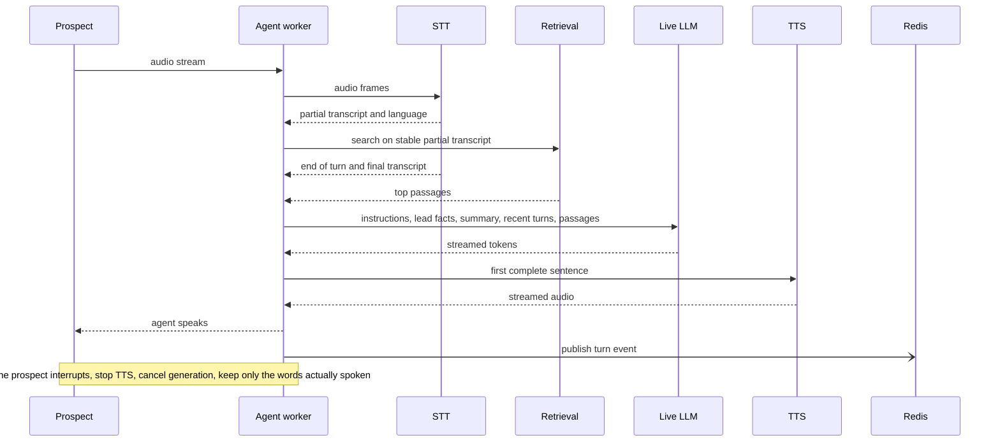
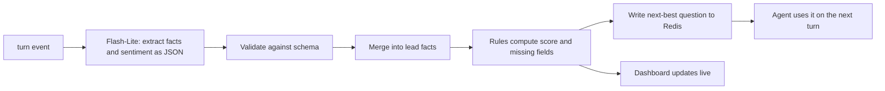
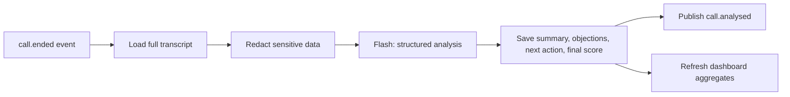

# AI Sales Voice Agent: System Design

Version 1.0 · 25 November 2026 · Status: design, pre-development

## 1. Business problem and scope

Sales teams lose leads because inbound enquiries wait for a human, early calls are repetitive qualification, many buyers prefer Hindi or Hinglish, and call notes are incomplete.

The product is a voice agent that talks to a prospect in real time, answers product questions from company documents, qualifies the lead, and gives the sales team a summary with a recommended next action.

### Scope

| In the MVP | Not in the MVP |
|---|---|
| Real-time voice (speech-to-text and text-to-speech) | Automated appointment booking |
| Contextual memory | CRM integration |
| Multilingual: English, Hindi, Hinglish | Phone (PSTN) calling; the MVP runs in the browser |
| Lead qualification and sentiment analysis | Outbound dialling campaigns |
| RAG knowledge retrieval | |
| Call summary and business insights | |

The excluded items can be added later as consumers of the `call.analysed` event (section 5.4) without changing the voice pipeline. The MVP stores leads in its own database.

## 2. Design principles

1. **Separate the fast path from the slow path.** Only what the caller is waiting for runs before the reply. Scoring, sentiment and summaries run asynchronously.
2. **Stream every stage.** Transcription, generation and synthesis overlap instead of running one after another.
3. **The model extracts, code decides.** The LLM pulls facts from the conversation; deterministic rules compute the lead score, so every score can be explained.
4. **Answer from the knowledge base or say so.** The agent does not invent prices, features or terms.
5. **Replaceable providers.** STT, TTS and LLM sit behind interfaces, so a vendor change is configuration.
6. **Stateless services.** Call state is mirrored to Redis, so any component can be scaled or restarted.

## 3. Architecture



## 4. Technology stack

| Layer | Choice | Reason | Alternative |
|---|---|---|---|
| Media and agent framework | LiveKit Agents (Python) | Open source, WebRTC, interruption handling, turn detection, SIP support for later telephony | Pipecat |
| STT | Sarvam Saaras (streaming) | Built for Indian languages and code-mixed speech; LiveKit plugin exists | Deepgram Nova-3 |
| TTS | Sarvam Bulbul (streaming) | Natural Indian-language voices at low per-character cost | Cartesia Sonic |
| Live LLM | Gemini 3.5 Flash-Lite, minimal thinking | Fast, low-cost tier ([$0.30 / $2.50 per million input / output tokens](https://ai.google.dev/gemini-api/docs/pricing)) | Claude Haiku, Groq-hosted open models |
| Post-call LLM | Gemini 3.8 Flash, structured output | Stronger reasoning where latency does not matter ($0.75 / $3.75 per million tokens until 31 December 2026, then $1.50 / $7.50) | Flash-Lite for lower cost |
| Embeddings | BGE-M3, self-hosted | Multilingual: a Hindi question can match an English document | Hosted embedding API |
| Database and vectors | PostgreSQL with pgvector | One store for records and vectors; enough for a per-company knowledge base | Qdrant if vector load grows |
| State and events | Redis (cache and Streams) | Low latency; one component for both in the MVP | Kafka or SQS at scale |
| API | FastAPI | Async, typed, shares code with the Python workers | NestJS |
| Frontend | Next.js, TypeScript, Tailwind, LiveKit client SDK | Call screen and dashboard in one app | React with Vite |
| Observability | OpenTelemetry, Prometheus, Grafana, Langfuse | Latency per stage and LLM traces | Datadog |
| Deployment | Docker Compose (MVP), Kubernetes (scale) | Same containers in both | Managed container service |

**To verify first.** Model choices need a benchmark on real prompts before they are fixed: run `scripts/benchmark.py` to measure first-token and first-audio latency. Use a paid Gemini tier for real customer data and check Google's data-use terms, which differ between free and paid use.

## 5. Workflows

### 5.1 End-to-end business workflow



### 5.2 One conversation turn (fast path)



Retrieval runs automatically on each substantive turn. It is not an LLM tool call, which would add a second model round trip.

### 5.3 Live intelligence (slow path, during the call)



This path may lag by a turn. If it fails, the conversation continues.

MVP implementation: the analysis runs as a background task inside the agent worker, writing to SQLite. Failed turns are retried with the next one. A separate worker fed by Redis Streams remains the scale-up design.

### 5.4 After the call



Jobs are idempotent by call ID, retried with backoff, and moved to a dead-letter stream after repeated failure.

## 6. Feature design

### 6.1 Real-time voice

- Start with the STT provider's server-side end-of-turn detection; compare it with the LiveKit turn detector (Hindi is [listed as supported](https://docs.livekit.io/agents/logic/turns/turn-detector/)) on recorded calls.
- A local voice activity detector (Silero) in the agent worker detects interruptions, so barge-in does not wait for a transcript.
- Speak sentence by sentence as tokens arrive.
- Keep replies to one to three sentences and ask one question at a time.
- On provider timeout, play a short holding phrase, retry once, then switch to the fallback provider.

**Latency budget** (end of user speech to first agent audio; targets, not yet measured):

| Stage | Target |
|---|---|
| End-of-turn detection | 300 ms |
| Final transcript | 150 ms |
| Retrieval wait (mostly overlapped) | 50 ms |
| LLM first sentence | 500 ms |
| TTS first audio | 200 ms |
| Network | 100 ms |
| **Total** | **about 1.3 s at the median, under 2 s at the 95th percentile** |

### 6.2 Contextual memory

| Tier | Contents | Store | Lifetime |
|---|---|---|---|
| Working | Last 8 to 10 turns | Worker memory, mirrored to Redis | Current call |
| Structured | Lead facts: name, company, need, budget, authority, timeline, objections | Redis, then PostgreSQL | Across calls |
| Rolling summary | Compressed older turns | Redis | Current call |
| Long-term | Past call summaries for a returning lead | PostgreSQL | Retention policy |

The prompt is ordered stable-first (instructions, persona, rules), then facts, summary, passages and recent turns. This keeps prompt size bounded and allows prompt caching where the prefix is long enough.

MVP implementation: memory is held in the agent process and SQLite (no Redis yet). A returning caller is recognised by a random id kept in their browser, so typing someone else's name cannot reveal their data.

### 6.3 Multilingual conversation

- STT detects the language on each turn, including code-mixed speech.
- The agent replies in the language of the latest substantive turn; a one-word "haan" or "ok" does not switch it.
- The TTS language follows the reply.
- Lead facts and summaries are stored in English; the transcript keeps the original language.
- Adding a language means adding configuration and evaluation calls, after checking STT, TTS and turn-detection support.

### 6.4 Knowledge retrieval (RAG)

MVP implementation: SQLite (full-text index plus exact vector comparison) stands in for PostgreSQL with pgvector, the embedding model is `multilingual-e5-large` instead of BGE-M3, and files are parsed with pypdf and python-docx instead of Docling. PostgreSQL, BGE-M3 and Docling remain the scale-up targets.

Ingestion: upload → parse (Docling) → split by headings into passages of about 400 tokens → embed with BGE-M3 → store with source, version and tenant ID.

Query: embed the question → vector search (HNSW) and keyword search → merge by reciprocal rank fusion → keep the top 4 above a relevance threshold.

- No passage above the threshold: the agent says a specialist will confirm, and logs a **knowledge gap**.
- Retrieved text is treated as data, never as instructions.
- The live path has no reranker, to protect latency. Add one only if evaluation shows poor ranking.
- Keyword search is weak for Hindi in default PostgreSQL, so cross-lingual matching relies on the vectors.

### 6.5 Lead qualification and sentiment

| Criterion | Weight | Full marks when |
|---|---|---|
| Need | 30 | A specific problem the product solves is stated |
| Budget | 25 | A range is given and fits the offer |
| Authority | 20 | The speaker decides or directly influences |
| Timeline | 25 | Purchase expected within 3 months |

Grades: **Hot** 70 and above, **Warm** 40 to 69, **Cold** below 40. Each fact stores the quoted sentence that supports it. Weights are configurable.

Sentiment is recorded per user turn (positive, neutral, negative, with a reason such as price concern) and as a trend over the call. Two consecutive negative turns flag the call for human follow-up. It is derived from text only; tone of voice is not analysed in the MVP. Sentiment is shown beside the score and does not change it.

### 6.6 Summaries and business insights

Per call: summary, lead facts, score with reasons, sentiment trend, objections, unanswered questions, recommended next action.

Across calls: calls and qualified rate, grade distribution, top objections, sentiment trend, knowledge gaps, language mix, average duration, response latency, cost per call. Numbers come from SQL aggregates, not from the LLM.

## 7. Data model

| Table | Key fields |
|---|---|
| `tenants` | id, name, settings (persona, weights, languages) |
| `leads` | id, tenant_id, name, contact (encrypted), company |
| `calls` | id, tenant_id, lead_id, started_at, ended_at, status, consent_at |
| `turns` | id, call_id, speaker, text, language, sentiment, latency_ms |
| `lead_facts` | lead_id, call_id, field, value, evidence_turn_id, confidence |
| `call_analysis` | call_id, summary, score, grade, objections, next_action, model |
| `kb_documents` | id, tenant_id, name, version, status |
| `kb_chunks` | id, tenant_id, document_id, content, embedding, tsv |
| `knowledge_gaps` | id, tenant_id, call_id, question |
| `audit_log` | actor, action, resource, at |

Core API: `POST /calls` (create and return a room token), `POST /documents`, `GET /calls`, `GET /calls/{id}`, `GET /insights`, `WS /calls/{id}/live`.

## 8. Scalability to 1,00,000 users

**Load assumptions** (to be replaced with real data): 2 calls per user per month, 5 minutes each, giving 10,00,000 minutes per month. Spread over 10 busy hours a day, this averages about 55 concurrent calls. With a peak factor of 4, plan for about 220 and provision for **500 concurrent calls**.

| Component | Scaling method | Sizing at 500 concurrent (estimate) |
|---|---|---|
| Agent workers | Autoscale on active calls; drain before shutdown | About 25 pods of 4 vCPU and 8 GB, at 20 calls each |
| LiveKit | LiveKit Cloud, or a self-hosted multi-node cluster | Rooms distributed across nodes |
| Embedding service | Horizontal replicas, query cache; GPU if needed | Load test to size |
| API and dashboard | Horizontal replicas | 3 or more |
| PostgreSQL | Connection pooling, read replica, monthly partitions for `turns` | Primary plus replica |
| Redis | Managed cluster with failover | 3 shards |
| Post-call workers | Autoscale on queue depth | Scales independently |

The likely first bottleneck is **provider rate and concurrency limits** (STT, TTS, LLM). Request enterprise limits, keep a fallback provider, and queue new calls when capacity is full.

| Stage | Users | Infrastructure |
|---|---|---|
| MVP | Demo | One machine, Docker Compose |
| Pilot | Up to 5,000 | Managed database and Redis, 2 to 3 worker nodes |
| Growth | Up to 25,000 | Kubernetes, autoscaling, read replica |
| Scale | 1,00,000 | Multi-zone, provider fallback, Kafka or SQS, second region for recovery |

## 9. Security and privacy

- **Transport and storage:** encrypted media (DTLS-SRTP), TLS for all APIs, encryption at rest, field-level encryption for contact details.
- **Access:** short-lived room tokens, role-based dashboard access, tenant ID enforced with PostgreSQL row-level security.
- **Consent:** the call states that the prospect is speaking with an AI and that it is transcribed, and records consent.
- **Data minimisation:** raw audio is not stored by default; card and ID numbers are redacted; transcripts have a retention period and a delete function.
- **Prompt injection:** caller speech and documents are untrusted; the agent has no destructive tools, and extracted output is schema-validated.
- **Abuse and cost control:** rate limits, maximum call duration, per-tenant spending cap.
- **Compliance:** design for India's Digital Personal Data Protection Act, 2023, with legal review. Confirm each AI vendor's processing location and retention terms before using real customer data. Phone calling would add telecom rules.
- **Secrets:** environment files locally, a secrets manager in production.

## 10. Operational cost

Estimates for one call minute, at ₹88 per US dollar. Assumes 450 synthesised characters, 6 turns, and about 3,000 input tokens per live turn.

| Item | Basis | USD per minute |
|---|---|---|
| STT | [₹0.49 per minute](https://docs.sarvam.ai/api-reference-docs/pricing) | 0.0056 |
| TTS | [Bulbul v4 Flash, ₹20 per 10,000 characters](https://www.sarvam.ai/blogs/bulbul-v4-flash) | 0.0102 |
| Live LLM | Replies plus extraction on 3.5 Flash-Lite | 0.0123 |
| Post-call LLM | 3.8 Flash at 2027 rates, about $0.015 per 5-minute call | 0.0030 |
| Media and agent hosting | [LiveKit Cloud overage rate](https://micdrop.dev/blog/livekit-pricing) of $0.01 per agent minute (third-party sources; confirm on the pricing page) | 0.0100 |
| **Total variable** | | **about 0.041 (₹3.6)** |

At 10,00,000 minutes a month:

| Cost | Monthly estimate |
|---|---|
| Variable AI and media | about $41,000 (₹36 lakh) |
| Database, Redis, API, embeddings, monitoring | $2,000 to $4,000 |
| **Total** | **about $43,000 to $45,000 (₹38 to 40 lakh)** |

Self-hosting media and agent workers replaces the $0.01 per minute fee with compute and operations effort. The figures exclude telephony, staff, taxes and volume discounts. Bulbul v3 (₹30 per 10,000 characters) would add about $0.005 per minute.

## 11. Commercial feasibility

- **Model:** business-to-business subscription with included minutes, plus overage.
- **Illustrative price:** ₹8 per minute against about ₹4 total cost, a gross margin near 50% before sales, support and staff costs. Price acceptance is untested.
- **Value:** instant response at any hour, consistent qualification, every call documented, sales time spent on Hot leads.
- **Pilot measures:** call completion rate, qualification accuracy against human review, lead-to-meeting conversion, cost per qualified lead.
- **Risks:** speech accuracy in noisy conditions, caller acceptance of AI, vendor price changes, wrong answers from outdated documents.

## 12. Quality and reliability

| Area | Measure | MVP target |
|---|---|---|
| Latency | Median voice-to-voice | 1.5 s or less |
| Retrieval | Correct passage in top 4, on 50 test questions | 90% |
| Grounding | Answers supported by passages | 95% |
| Qualification | Grade agreement with human on 20 scripted calls | 85% |
| Language | Correct reply language | 95% |

## 13. Repository layout and build plan

```text
ai-voice-agent/
├── apps/
│   ├── agent/          # LiveKit worker: pipeline, memory, prompts, providers
│   ├── api/            # FastAPI: calls, documents, insights
│   ├── workers/        # live intelligence, post-call, ingestion
│   └── web/            # Next.js: call screen and dashboard
├── packages/core/      # shared schemas, scoring rules, retrieval
├── evals/              # test questions, scripted calls
├── infra/              # docker-compose, Kubernetes manifests
└── docs/
```

| Phase | Deliverable | Done when |
|---|---|---|
| 0 | Provider benchmark and accounts | Latency of STT, LLM and TTS measured |
| 1 | Voice loop in the browser | English and Hindi conversation with interruption |
| 2 | RAG | Answers cite uploaded documents |
| 3 | Memory and live qualification | Score and sentiment update during a call |
| 4 | Post-call analysis and dashboard | Summary and insights visible after hang-up |
| 5 | Evaluation, security basics, demo | Targets in section 12 reported |

### Demonstration script

1. Upload a product brochure and price list.
2. Start a call in English, then switch to Hindi.
3. Ask a pricing question, then one the documents do not cover.
4. State a need, budget, role and timeline, and raise an objection.
5. Interrupt the agent mid-sentence.
6. End the call and show the summary, score with evidence, sentiment, knowledge gap and dashboard.
